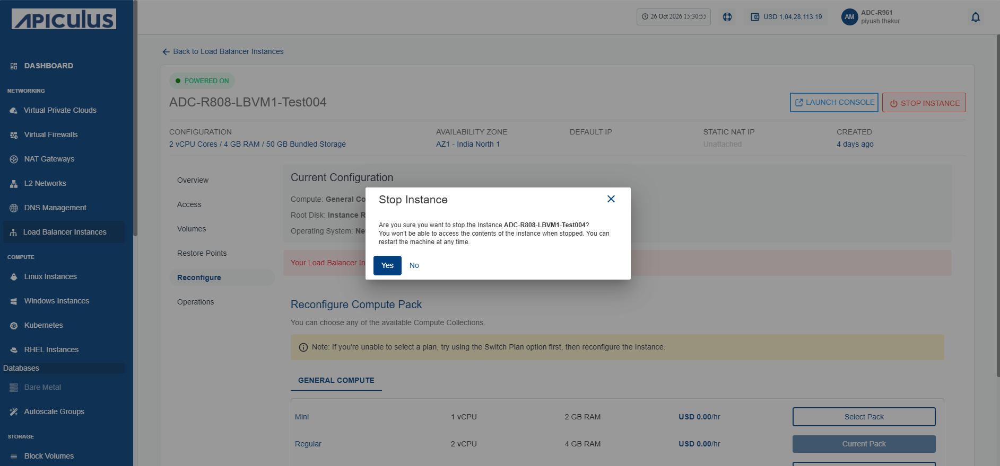
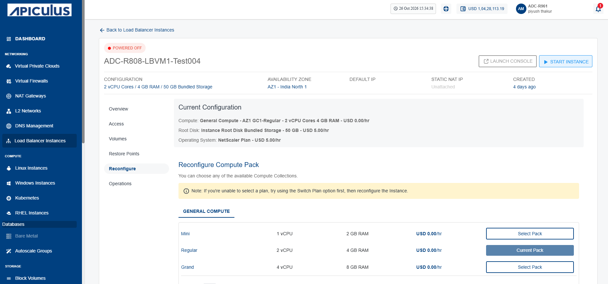
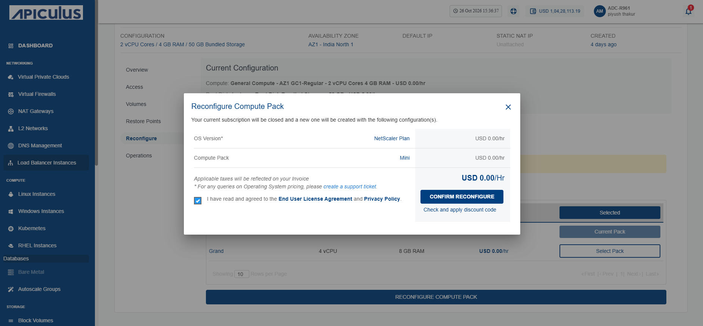

# Reconfiguring Load Balancer Instance

Reconfigure a load balancer instance to change its compute configuration when your workload requirements change. Updating the compute pack allows you to allocate resources that better match your application's performance and capacity needs.

To reconfigure the load balancer instance, follow these steps:

1. Navigate to **Networking > Load Balancer Instances**. The following screen appears:
	
2. Click on your created load balancer instance name from the list, and click **Reconfigure**.
3. Click the **Stop Instance** button. The following screen appears:
	
4. Click the **Yes** button. The following screen appears:
	
5. Select a **Compute Pack** from the list, and click the **Reconfigure Compute Pack** button. The following screen appears:
	
6. Select the **I have read and agreed to the Yntraa Cloud Terms and Conditions and Privacy Policy** option, and click the **Confirm Reconfigure** button.
