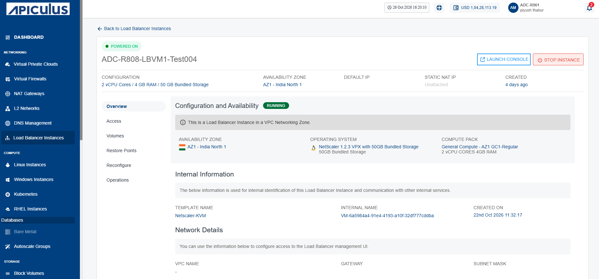
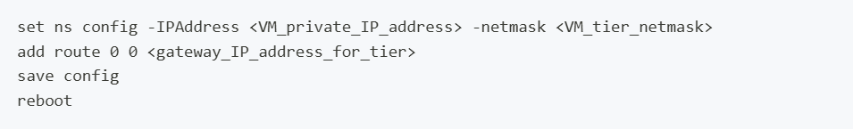
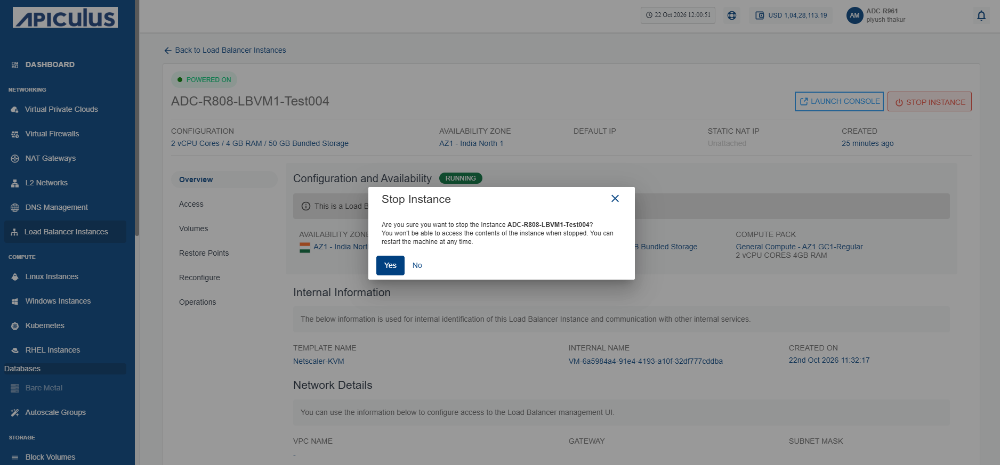
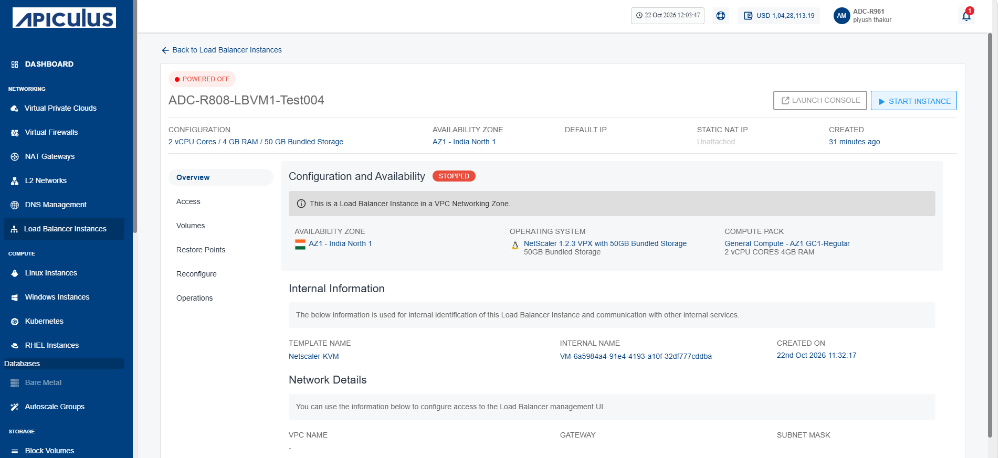

# Viewing Load Balancer Instance Details

Load balancer instance details provide an overview of the instance, including its current status, configuration, internal information, and network details. This information helps you monitor the instance, verify its configuration, and manage network connectivity effectively.

This comprises of the following sub-sections:
- [Launching LBI Web Based Console](#launching-lbi-web-based-console)
- [Stopping and Starting Load Balancer Instance](#stopping-and-starting-load-balancer-instance)

To view the details of a load balancer instance, follow these steps:

1. Navigate to **Networking > Load Balancer Instances**. The following screen appears:
	
2. Click on your load balancer. The following screen appears:
	
The screen shows the following details:

- **Configuration and Availability:** This section displays the following details to help verify load balancer instance current configuration and operational state:
    
    - The instance's status **Running** or **Stopped**
    - Availability Zone
    - Operating System
    - Compute Pack
- **Internal Information:** This section displays the following information used for internal identification of a load balancer instance and communication with other internal services:
    
    - Template Name
    - Internal Name
    - Created On
- **Network Details:** This displays the following network interface details associated with the load balancer instance to help identify and manage its network connectivity:
    
    - VPC Name
    - Gateway
    - Subnet Mask

## Launching LBI Web Based Console

Launch the LBI Web Based Console to access the browser-based management interface for your load balancer instance. The console enables you to configure and manage load balancing settings, monitor traffic and system health, and perform administrative tasks from a web browser.

To launch LBI web based console, follow these steps:

1. Navigate to **Networking > Load Balancer Instances**. The following screen appears:
	
2. Click on your created load balancer instance name from the list.
3. Click the **Launch Console** button to access the Instance's console interface. One-by-one, run the following commands:
	
## Stopping and Starting Load Balancer Instance

Stop the load balancer instance to apply updates, perform maintenance, or optimize resource usage. This action suspends firewall operations without deleting configurations and quickly restores protection when restarted.

To start and stop the load balancer instance, follow these steps:

1. Navigate to **Networking > Load balancer Instances**. The following screen appears:
	
2. Click on your created load balancer instance name from the list.
3. Click the **Stop Instance** button. The following screen appears:
	
4. Click the **Yes** button. The following screen appears:
	
5. Click the Start Instance button to restart the load balancer.