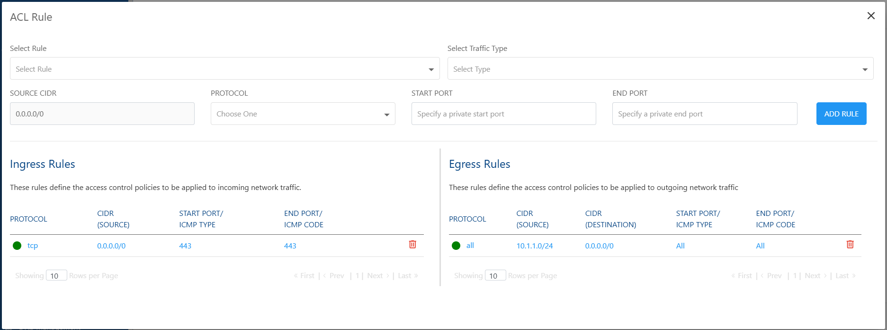
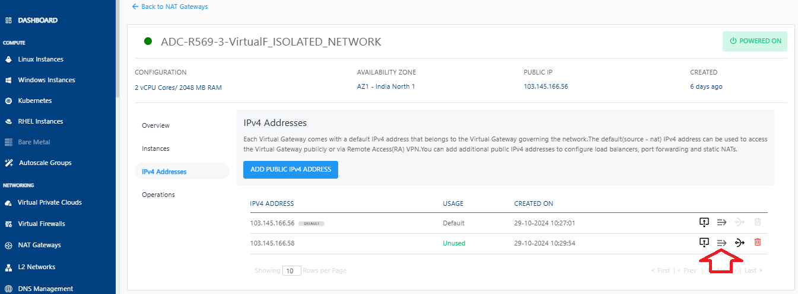
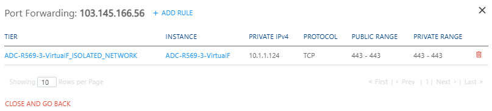
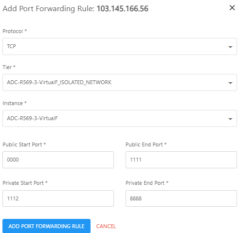

# Managing IPv4 Addresses
Each virtual gateway comes with a default IPv4 address that belongs to the Virtual Gateway governing the network. The default (source - NAT) IPv4 address can be used to access the Virtual Gateway publicly or via Remote Access (RA) VPN
## Adding Public IPv4 Addresses
A public IPv4 address uniquely identifies a resource on the internet and enables communication with external networks. Add a public IPv4 address to a NAT Gateway to allow private instances to access the internet and external services while keeping them protected from direct inbound internet traffic.

To add a public IPv4 address, follow these steps:

1. Navigate to **Networking > NAT Gateways**. The following screen appears:
	
2. Click a NAT Gateway name from the list.
3. Click **IP Addresses**. The following screen appears:
	
4. Click the **Add Public IPv4 Address** button. The following screen appears:
## Managing Firewall Rules
1. Click the **Firewall Rules** icon.
   
2. Enter the details as shown to create a new firewall rule.
	1. Select Traffic Rule from the drop-down list.
	2. Enter the Source CIDR.
	3. Select the Protocol from the drop-down list.
	4. Enter the Start Port. 
	5. Enter the End Port.
	6. Click on **Add Rule**.
    

## Managing Port Forwarding Rules
1. Click the **Port Forwarding Rule** icon.
   
	The following screen appears where you can view the already created port forwarding rules.
	
2. To add a new rule, click on **Add Rule**.
   

3. Enter the required details to add a rule.
   

5. Click the **Add Port Forwarding Rule** button.
   

## Changing Source NAT IPv4 Address
1. Click the **Source NAT** icon.
   

2. Click **OKAY**.  
   
   
## Deleting IP Address
1. Click the **Delete IP** icon.
   
2. Select the **I confirm that I have remove everything from this IPv4 Address** option and click the **Delete Now** button.
   
	:::warning
	This is an irreversible action.
	:::

