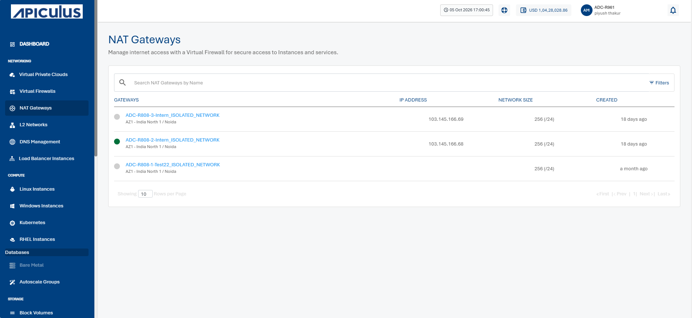
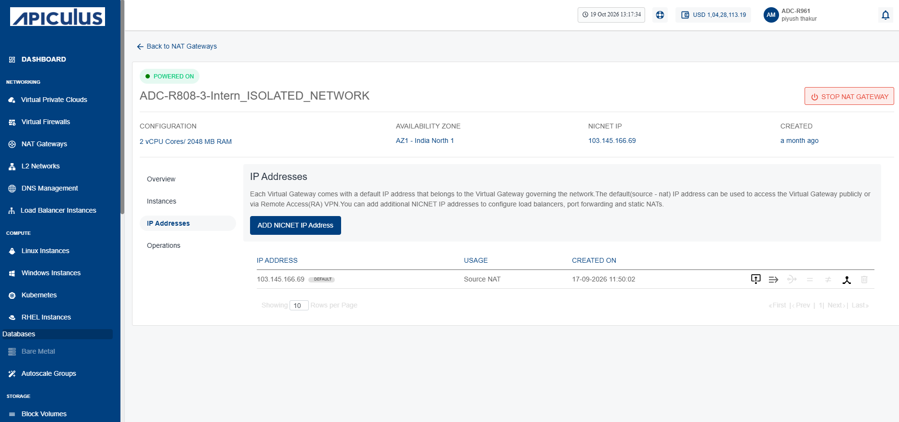
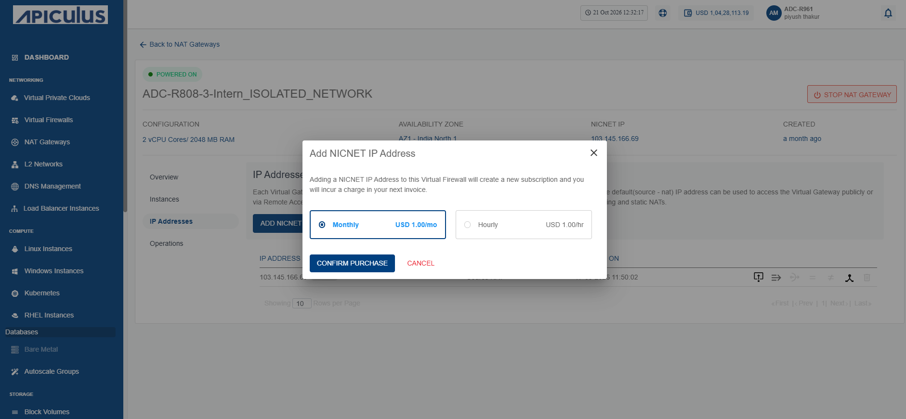
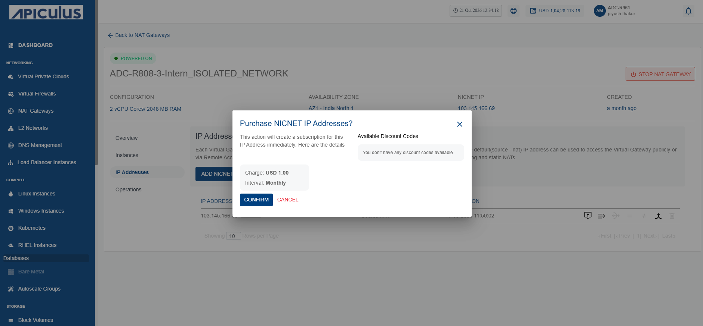
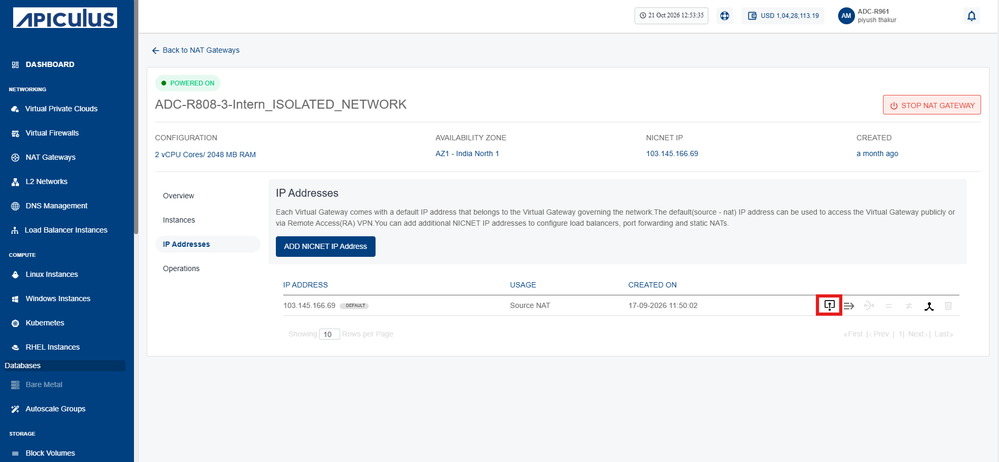
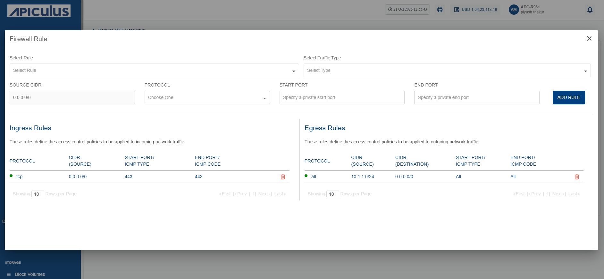
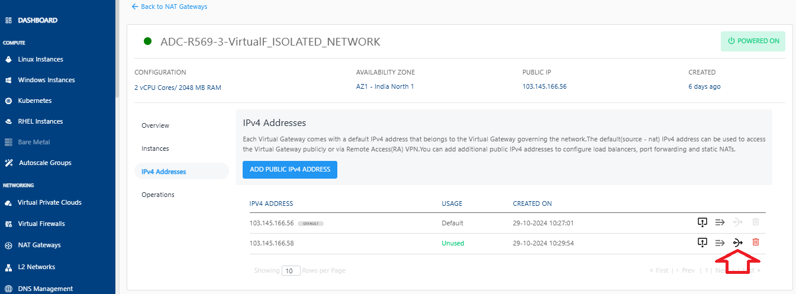
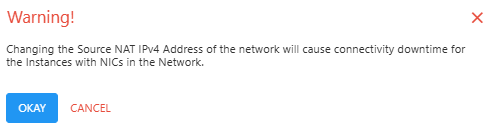
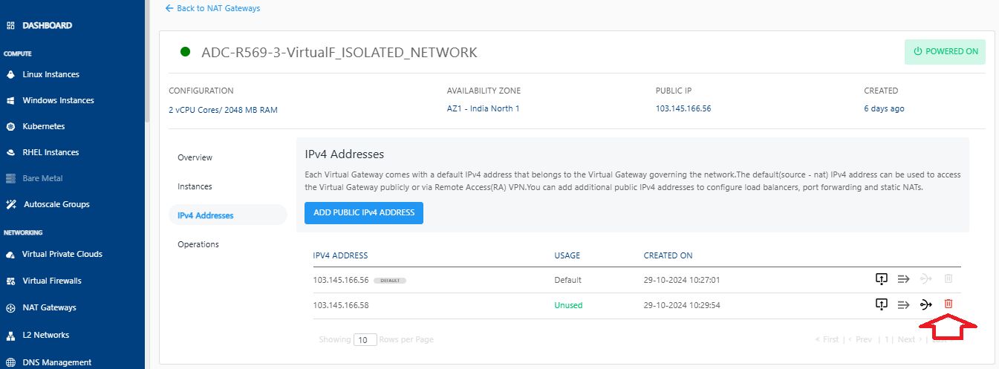
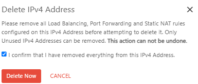

# Managing IPv4 Addresses
Each virtual gateway comes with a default IPv4 address that belongs to the Virtual Gateway governing the network. The default (source - NAT) IPv4 address can be used to access the Virtual Gateway publicly or via Remote Access (RA) VPN
## Adding Public IPv4 Addresses
A public IPv4 address uniquely identifies a resource on the internet and enables communication with external networks. Add a public IPv4 address to a NAT Gateway to allow private instances to access the internet and external services while keeping them protected from direct inbound internet traffic.

To add a public IPv4 address, follow these steps:

1. Navigate to **Networking > NAT Gateways**. The following screen appears:
	
2. Click a NAT Gateway name from the list.
3. Click **IP Addresses**. The following screen appears:
	
4. Click the **Add Public IPv4 Address** button. The following screen appears:
	
5. Select the **Monthly** option and click the **Confirm Purchase** button. The following screen appears:
	
6. Click the **Confirm** button.

The public IPv4 address is added where you can perform the following actions:
- [Adding Firewall Rules](#adding-firewall-rules)
- [Adding Port Forwarding Rules](#adding-port-forwarding-rules)
## Adding Firewall Rules
A firewall rule defines how a NAT Gateway allows or blocks network traffic based on specified criteria, such as IP addresses, ports, and protocols. Adding firewall rules helps control network access, enhance security, and ensure that only authorized traffic passes through the NAT Gateway.

To add a firewall rule, follow these steps:

1. Navigate to **Networking > NAT Gateways**. The following screen appears:
	
2. Click a NAT Gateway name from the list.
3. Click **IP Addresses**. The following screen appears:
	
4. Click the **Firewall Rule** icon (highlighted in red). The following screen appears where you provide the required details:
	
5. Click the **Add Rule** button. The firewall rule is added.
## Managing Port Forwarding Rules
1. Click the **Port Forwarding Rule** icon.
	   

## Changing Source NAT IPv4 Address
1. Click the **Source NAT** icon.
   

2. Click **OKAY**.  
   
   
## Deleting IP Address
1. Click the **Delete IP** icon.
   
2. Select the **I confirm that I have remove everything from this IPv4 Address** option and click the **Delete Now** button.
   
	:::warning
	This is an irreversible action.
	:::

